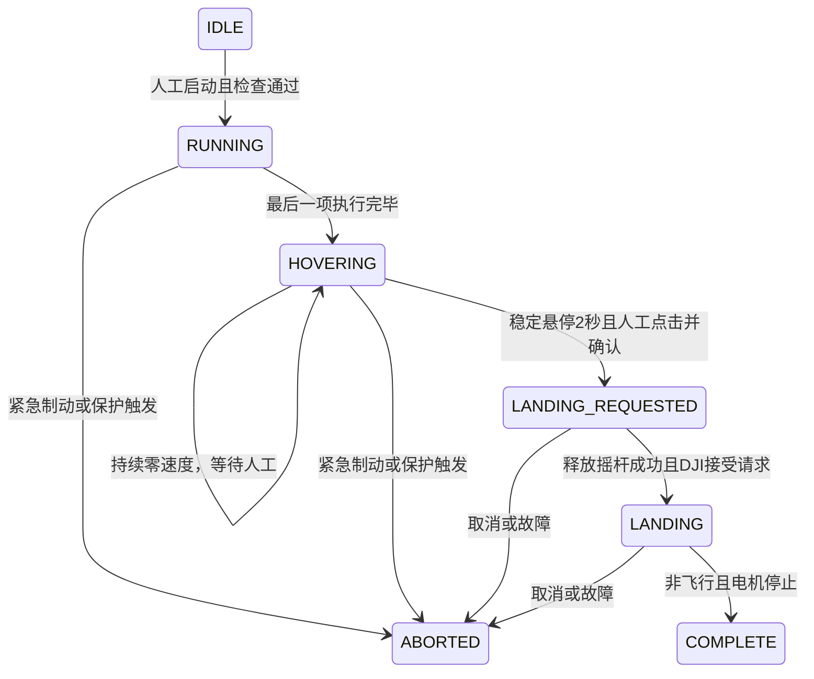

# 第一阶段设计（v1.1）

目标流程：先设置模拟方向队列，操作员手动起飞并定位；启动后仅执行同高度的水平移动；队列结束持续悬停；人工单独申请降落或交还遥控器。没有自动起飞、位置到达判据或到达后自动降落。

## 状态与触发

`ABORTED` 不允许续播；必须先确认 SDK 交接完成，再由操作员明确开启一个新实验。队列完成、WAIT、0°、等待时间都不能自动触发降落。进入 HOVERING 后没有自动降落倒计时。

## 线程与命令路径

- `DirectionQueue`：解析最多 120 项/60 秒的有限队列。
- `AcousticLandingController`：500 ms 方向时隙、几何变换、运行保护、悬停与显式降落状态；纯 Java。
- `SessionWatchdog`：跨线程会话令牌与 350 ms 界面心跳期限；过期/停止后锁存，迟到心跳无效。
- `DjiFlightBridge`：独立 HandlerThread，串行处理遥测、控制循环和 SDK 回调；100 ms 周期发送。界面仅发送人工操作和心跳。
- `AcousticLandingActivity`：编辑参数、人工确认、状态与日志；本地模拟不调用实际飞行控制。

遥测时间取 SDK 回调收到的时刻，数值也取该次回调；不会把延迟处理旧回调的时间当作新遥测。遥测包括姿态、高度、速度，三者最旧时间决定是否过期。连接、飞行、电机、定位、模式、电量另行监听；未知的飞行/电机状态不能当作落地。

BODY + VELOCITY 命令按现有 DJI 速度轴约定映射：`roll=forward`、`pitch=right`。水平速度由地理北/东转换；竖直速度为 0，偏航角速度为 0。保持高度依赖飞控，本项目还监测相对启动高度偏差；并不以绝对高度位置模式强制追高。参考 [DJI Virtual Stick API](https://developer.dji.com/api-reference-v5/android-api/Components/IVirtualStickManager/IVirtualStickManager.html)。轴映射必须用实际机型低速验证。

## 当前限制

| 项目 | 规则 |
| --- | --- |
| 速度 | 默认 0.1，允许 0.05–0.3 m/s |
| 队列 | 1–120 项，每项 500 ms，总时长最多 60 秒 |
| 路程 | 启动时预计数字方向指令路程 ≤3 m；运行积分超过 3.1 m 终止（含调度余量），均非真实距离 |
| 高度 | 相对起飞点 2–8 m；运行期间偏离启动高度超过 0.5 m 终止 |
| 实测速率 | 水平超过 1 m/s 或垂直绝对值超过 0.5 m/s 终止 |
| 启动 | 已飞行且电机开启；电量≥30%；连续有效稳定悬停 2 秒 |
| 定位 | GPS 4/5/10 级或飞控报告正在使用视觉定位；否则拒绝 |
| 飞行模式 | 只允许 GPS_NORMAL、GPS_TRIPOD、VIRTUAL_STICK；拒绝 ATTI、UNKNOWN、其他自动任务和运动模式 |
| 电量 | 运行中低于 20% 或无效时终止；保留飞控自身电量保护 |
| 新鲜度 | 姿态/高度/速度超过 750 ms，或控制间隔/界面心跳超过 350 ms，终止 |
| 降落授权 | 队列完成后实测水平/垂直速度均≤0.2 m/s，持续 2 秒，再由人工点击及二次确认 |

## 停止和异步动作

红色按钮首先在调用线程撤销会话令牌，随后在控制线程停止队列，发送零速度；在短暂零速度阶段后请求释放虚拟摇杆。只取消本适配器发起/尚未确认的降落。没有关闭电机指令。

申请控制权、释放控制权、启动降落、最终确认均可能异步返回。停止后迟到的获取控制权成功回调会释放控制权；迟到的降落成功回调会再次取消降落。停止/释放/取消尚未确认时禁止新会话。SDK 失败显示接管提示；不会宣称飞机已经悬停。

人工降落先发送零速度并等 `disableVirtualStick` 成功，重新核对会话与遥测后才调用 `KeyStartAutoLanding`。最终降落确认也是单独人工操作。参考 [DJI 起降接口](https://developer.dji.com/api-reference-v5/android-api/Components/IKeyManager/Key_FlightController_FlightControllerKey.html)。

App 离开前台立即撤销会话；返回不恢复。主线程卡顿由独立控制线程检测，整个进程/SDK/控制线程被系统卡死则不能靠本软件保证处置。无 GPS 时也无法检测真实水平越界。实机必须保留物理遥控器接管与独立观察。
