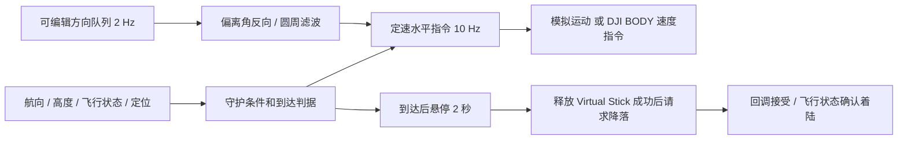

# 第一阶段设计

## 可观测性与任务边界

地面阵列接收旋翼声，只返回水平偏离角，不返回距离。第一阶段先测试“方向输入 → Android 处理 → 飞行控制 → 到达确认 → 降落”的链路，不声称解决纯声学定位问题。

现场约束已经确定：无 GPS，操作员先把无人机飞到预定降落点上方，再测试模拟方向和降落控制链路。因此默认 `OPERATOR` 判据、`WAIT*120` 队列，不填写或使用目标经纬度。模拟初始位置也在目标正上方。需要测试水平响应时，用户明确编辑角度队列；移动后不能假定仍在目标上方。

一个时刻的单一方位角对应一条射线。沿同一射线、距离不同的位置会返回同一角度，因此“角度稳定”“连续收到零度”“队列播放结束”都不能证明已到达目标。`0°` 代表北向，不代表位置误差为零。

当麦克风阵列与降落点不重合时，阵列的角度原点和降落目标的原点不同，不能直接把“阵列 → 无人机”角度当成“目标 → 无人机”角度。后续可结合已知运动和多时刻观测、多个阵列、额外定位或到达检测，但必须单独建立估计器并验证。

当前实现默认使用人工判据，同时保留附加位置演示：

| 判据 | 水平控制输入 | 到达依据 | 用途 |
| --- | --- | --- | --- |
| 人工确认（默认） | 默认 WAIT 悬停，可编辑方向，每 500 ms 一个 | 操作员确认已在目标上方，再悬停 2 秒 | 现场无 GPS 的控制链路实验 |
| 位置判据（主动切换） | 模拟偏离角，每 500 ms 一个 | 本地模拟位置 / 实机 WGS84 GPS 到目标半径，连续 2 秒 | 附加位置演示 |

GPS 只用于位置判据和范围保护，不参与从角度计算水平指令；因此任意填写的方向队列不一定会收敛到 GPS 目标。GPS 参与到达判断意味着该模式不是纯声学定位。人工模式没有位置范围保护，15 m 的“指令路程”仅是速度命令积分，不能当作实际距离。

## 数据流与状态

状态依次为 `IDLE → ALIGNING → HOLDING → LANDING_REQUESTED → LANDING → COMPLETE`。位置离开到达半径时 `HOLDING → ALIGNING`，计时清零。错误或操作员停止转为 `ABORTED`，该次实验不会自行恢复。

输入 500 ms、输出 100 ms 分离；方向之间持续发送最近滤波后的指令。DJI 建议高级摇杆指令发送频率为 5–25 Hz，当前选 10 Hz，见 [Virtual Stick 官方 API](https://developer.dji.com/api-reference-v5/android-api/Components/IVirtualStickManager/IVirtualStickManager.html)。

## 控制与限制

偏离角 `θ` 是目标指向无人机的地理方向。修正向量为 `(-cos θ, -sin θ)`，分别对应北、东；做二维向量指数滤波后归一化并乘配置速度。权重为旧值 0.65、新值 0.35，处理 359°/1° 跨界。`WAIT` 清除方向与滤波历史，立即发送零水平速度。

模拟使用北/东坐标积分，不模拟风、延迟、惯性、GNSS 误差或地面效应。模拟下降速度为 0.5 m/s，仅供流程展示。

实机按照航向把北/东速度变换到机体坐标，使用 `BODY + VELOCITY`、零角速度和零垂直速度。DJI 的 VELOCITY 参数沿坐标轴解释：`roll` 对应前向 X 速度、`pitch` 对应右向 Y 速度；不要将它们当作 ANGLE 模式的姿态角。参考 [坐标系概念](https://developer.dji.com/doc/mobile-sdk-tutorial/en/basic-introduction/basic-concepts/flight-controller.html) 与 [速度参数解释](https://developer.dji.com/api-reference/android-api/Components/FlightController/DJIFlightController.html?pbc=mF6h4ZTt)。这一映射必须在设备或受控仿真联调中先验证。

| 守护项 | 当前值 / 行为 |
| --- | --- |
| 水平速度 | 默认 0.3 m/s；可配置 0.05–0.5 m/s |
| 相对起飞点高度 | 接近和悬停阶段要求 2–15 m；不是测得的离地高度 |
| 方向 / 周期遥测 | 超过 1.5 s 停止；位置模式要求 GPS 等级 4、5 或 10 |
| 控制循环 | 间隔超过 500 ms 停止 |
| 总接近时长 | 120 s |
| 到达半径 | 默认 0.8 m，可配置 0.5–3 m；不代表 GPS 达到该精度 |
| 位置范围 | GPS 判据下距目标超过 30 m 停止 |
| 累计指令路程 | 超过 15 m 停止；不等于实际轨迹长度 |
| 队列 | 有限，1–1200 个采样，不隐式循环；结束时停止，不触发降落 |
| 到达 | 连续满足位置半径或人工确认后悬停 2 s |

不自动起飞，不在接近阶段下降。确认到达后停止水平指令，等待摇杆释放成功，再调用 DJI 自动降落。成功回调只表示请求被接受；`KeyIsFlying=false` 才记录落地完成。若飞控要求最终确认，操作员点击“确认 DJI 最终降落”，不自动绕过确认。若释放摇杆失败，不调用降落接口。

页面离开前台会停止实验。控制权被遥控器取回时停止，不自动重抢。停止功能发送零速度、释放摇杆，并取消已请求的自动降落；这些操作仍取决于 SDK 和通信链路，须保留遥控器接管能力。

## 后续工作

1. 设备验证注册、连接、周期遥测、轴映射、停止、降落取消和落地状态。
2. 确定阵列测量坐标系与目标坐标系，以及不同原点之间的转换。
3. 给阵列输入增加通信、时间戳/序号检查和质量字段；过期输入沿用当前停止策略。
4. 在独立定位/到达检测成立后，再研究真正无 GPS 的声学闭环。
