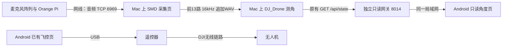

# VoiceSep 在 Mac 上部署与手机只读角度测试

更新：2026-11-20。当前完成的是“阵列采集/电脑测角接口 → 独立只读网关 → Android 角度显示”。已有无人机控制、队列、急停和人工降落逻辑保留；本轮没有把缺少采集端同步时间戳的网络结果直接交给实机飞控。

## 1. 原项目与桥接独立存放

VoiceSep 已通过当前账号的 SSH 授权克隆到：

```text
/Users/zheng13/Study/project/VoiceSep
```

检查基准为 `654945d91cdb79358d0c05f27bec5c847621484d`。原仓库源码保持干净，不改算法、接口或硬件配置，也没有向该协作仓库提交/推送。

桥接和部署工具单独放在：

```text
/Users/zheng13/Study/project/DJI-acoustics-autolanding-android/scripts/voicesep/
```

- `gateway.py`：只调用原系统 `GET /api/state`，整理公开角度字段，提供 `/api/state`、`/health` 和只读网页；不转发开始/停止/修改配置、录音或音频下载。
- `stack.py`：启动、查看、正常关闭本工具创建的三个进程；不抢占端口或结束其他进程。
- `local_credentials.py`：读取本机忽略配置，仅向原SMD本机 `/api/credentials` 加载会话凭据；不回显、不采样、不传给手机。
- `audio_demo.py`：独立测试端口，合成十三路 WAV，再调用原 VoiceSep 算法测角；不连接阵列和无人机。
- `mac_compat/winsound.py`：仅给 Mac 的 SMD 子进程提供校准播放兼容模块。原程序按下“校准采样时钟”时才会使用 `afplay` 播放原测试音；不修改 VoiceSep 源文件、不全局安装模块、不改变系统音量。
- `verify_upstream.py`：运行原 SMD 测试；Mac 下仅隔离原 Windows 测试对 `os.name` 的临时修改，不改原测试文件和断言。

环境位于 `VoiceSep/.venv`，使用 Python 3.12，按原 `requirements.txt` 安装。采集、测角页面各自带静态网页，不需要同时启动原 8000/5173 录音研究工作台。

## 2. 已找到的角度接口

这次应接 **`research/DJ_Drone` 的实时接口**，不是原录音工作台的逐块预览接口。

| 项目 | 代码位置与含义 |
| --- | --- |
| 角度产生 | `research/DJ_Drone/processing.py` 的 `DroneProcessor.process()`：`azimuth_deg = selected["angle"]`，没有有效目标时为 null |
| 事件序号和发布时间 | `research/DJ_Drone/runtime.py` 的 `_publish()`：递增 sequence，记录 emitted_at 和结果新鲜度 |
| HTTP 查询 | `research/DJ_Drone/app.py` 第 76 行附近：`GET /api/state` |
| WebSocket | 同文件第 130 行附近：`/ws`，消息为 `{type:"state", state:...}` |
| 更新周期 | `audio_core/settings.py` 的 `ProcessingSettings.update_seconds` |

HTTP 状态中主要检查：`active`、`valid`、`azimuth_deg`、`run_id`、`epoch`、`sequence`、`configured_update_ms`、`result_age_ms`、`input_age_ms`、`backlog_ms`。

只有 `active=true` 且 `valid=true` 才有可用角度。`valid=false` 时不能把 null 换成 0°。同一状态会被重复查询/推送，用 `run_id + epoch + sequence` 去重；WebSocket 约 50 ms 的心跳不是新角度产生周期。

原服务默认只监听电脑回环地址 `127.0.0.1:8011`。本方案保持这一设置，通过独立网关让手机读取，原来的控制接口不直接暴露到局域网。

## 3. 周期与角度定义

真实定位周期来自算法参数：

```text
周期毫秒 = 1000 × hop × localization_step / 16000
```

| 窗长 nfft | 步长 hop | 定位更新步数 | 周期 |
| --- | --- | --- | --- |
| 512 | 256 | 8 | 128 ms，约 7.8125 Hz（原默认） |
| 512 | 256 | 4 | 64 ms |
| 512 | 192 | 8 | 96 ms |
| 512 | 256 | 16 | 256 ms |

在电脑测角页面停止本轮，选择合法参数后重新开始。手机自动读取 `configured_update_ms`，据此调整轮询和过期显示；不要求始终为128 ms。手机“备用周期”只在服务没有返回周期时使用，不会改变电脑算法产出频率。

VoiceSep 的角度定义为 **阵列 +x 方向 0°、+y 方向 90°、逆时针递增**。手机罗盘使用相同约定，显示声源所在方向，不随手机朝向转动。源码默认搜索网格为 2°；输出可带小数，但不等于保证 1°实测误差。

未来若用于原阵列回放/控制转换，应选择“逆时针”，另行填入阵列 +x 轴的地理朝向 γ。音源地理方位为 `normalize(γ - azimuth_deg)`，修正方向再反向180°；不能照搬旧的顺时针假设。目标与阵列水平原点不一致时，仍需要额外位置估计。

## 4. 实际连接方式



本次先验证 A–E。E 不调用飞控；F–H 是之前已经验证的独立控制链路，实时自动飞行绑定仍需时延/坐标和现场验证。

### 阵列到 Mac

用户提供的入门手册明确使用 Orange Pi Zero2 的有线网口，默认固定IP为 `192.168.3.102`；通讯协议规定 UDP 6769 搜索、UDP 6869 控制、TCP 6969 音频流。现有 SMD 程序还通过 SSH 管理原 SDK。当前链路不是把一个 USB 麦克风直接插到手机。

1. 保持已有阵列和驱动板正确装配，按设备要求供电；网线连接 Orange Pi 与 Mac 的以太网口/已有 USB-C 网卡，也可以通过现有可达的局域网连接。
2. Mac 的阵列侧网卡要能到达设备地址。如果是直接连接，使用同网段且未占用的地址，例如 `192.168.3.10`、掩码 `255.255.255.0`；设备继续用 `.102`。这些是网络规划示例，实际地址先核对，不自动替你更改网卡。
3. 保留 Mac 的 Wi-Fi 与 Android 在同一局域网。Mac 的有线阵列网段与手机 Wi-Fi 网段可以不同，桥接程序在 Mac 上转换数据，不要求手机直接访问阵列板。
4. 本次观察到 Mac 的 Wi-Fi 地址为 `172.27.129.194`；如果换网或重连，需重新查看，不能把这个地址永久写死。
5. 校园网若有客户端隔离，手机可能无法访问 Mac。可改用你已有的私有路由或让 Mac 连接手机热点；同时保证 Mac 的有线阵列链路可达。

本次接线后的检查：Realtek USB 千兆网卡已识别为 `en5`，链路 `active / 1000baseT`。有线地址已设为 `192.168.3.10 / 255.255.255.0`，网关留空，到 `.102` 的路由走有线，Wi-Fi继续承担默认路由。ping三次无丢包、平均约1.07ms，SSH身份与原程序预期一致。TCP6969返回拒绝连接表示当时音频SDK尚未监听，不能把它误认为网线仍不通。后续准备/校准需在原采集页进行。

手册的入门例子是4麦线阵，当前代码按13麦十字阵列处理，不能照示例改成4路。手册中的刷TF卡、删除旧SDK和升级步骤不是本次部署动作；现有已可用设备继续按原配置使用。

### Mac 到手机

- Mac：运行采集、测角和网关。
- 手机：通过 Wi-Fi 读取网关，原 USB 口留给遥控器；不同时用同一个 USB 口连接 Mac 和遥控器。
- 没有无人机时，手机只用 Wi-Fi 即可测试。安装 APK 时可以先 USB 连 Mac，安装后再断开。
- 网关采用仅局域网使用的 HTTP；Android 客户端只允许私有/回环 IPv4，禁止重定向到公网。该页没有任何飞行指令入口。

## 5. 当前 Mac 服务及管理

| 地址 | 用途 |
| --- | --- |
| `http://127.0.0.1:8012` | SMD 设备准备、校准、录音，只在 Mac 操作 |
| `http://127.0.0.1:8011` | DJ_Drone 参数、开始/停止测角，只在 Mac 操作 |
| `http://127.0.0.1:8014` | 只读角度网页和网关 |
| `http://Mac的WiFi地址:8014` | Android App 或手机浏览器访问 |

在终端运行：

```bash
cd /Users/zheng13/Study/project/DJI-acoustics-autolanding-android
python3 scripts/voicesep/stack.py status
```

关机或服务退出后启动：

```bash
python3 scripts/voicesep/stack.py start
```

实验完成后，先在 SMD 页结束实验，在 DJ_Drone 页停止并封存，再正常关闭本工具启动的服务：

```bash
python3 scripts/voicesep/stack.py stop
```

日志/PID 记录在忽略的 `artifacts/voicesep-stack/`。脚本不自动开机启动，不抢占已用端口，不关闭其他项目的服务。

Mac 兼容注意：使用本启动脚本，校准播放兼容模块只注入 SMD 子进程。设备账号/密码已按用户要求保存在忽略的本机 `secrets.properties`（权限600），每次start会通过原系统API加载到内存。网页密码框留空即可；原“首次填写”提示不代表外置加载失败，不勾选Windows加密保存。若原服务被单独重启，可执行 `python3 scripts/voicesep/stack.py load-credentials`。原“打开文件夹”按钮仍是 Windows 功能，Mac 可用“复制路径”，然后在 Finder 的“前往文件夹”中粘贴。

## 6. 不连接无人机的真实声音测试

1. 安装 v1.4 APK，打开主页面，点击 **“阵列实时角度（只读，不接无人机也可）”**。这个页面不要求 DJI 注册或飞机连接，也不会申请虚拟摇杆。
2. 手机输入 `http://Mac的WiFi地址:8014`，点击“连接只读角度”。也可先在手机浏览器打开同一地址检查网络。
3. Mac 打开 SMD 页，用户名保留root、密码框留空（启动器已加载本机凭据）。先核对是否有同设备、同配置、同SDK的有效校准记录；记录不绑定Mac，可以在验证匹配后复用。没有可信记录而选择原校准方法时，把Mac扬声器放在阵列附近、取消静音，再点击“校准采样时钟”；原程序会播放约4秒测试音并采样核实。成功后点击“准备设备”，等待进入预览。设备自报48kHz不一定是真实采样时钟，不要凭文字说明直接猜24kHz。详细步骤、无声替代方法的边界及日志查看见 [测试手册](testing-runbook.md)。
4. SMD 选择 **前13路、16 kHz流式保存**，填一个新的实验名称并开始录音。不要使用24kHz原始WAV直接输入DJ_Drone。
5. 复制该实验目录到 DJ_Drone 页的“音轨所在目录”，先检查输入。选 **单一主声源**，暂不选旋翼筛选，不必生成分离音频，然后开始监测。
6. 用持续人声或宽带音箱声音在已知方向发声，先让声源与阵列近似同平面，依次测试 +x、+y 和其他方位。手机应显示原始角度、箭头、配置周期、结果年龄和去重序号。
7. 没有有效目标、处理停滞或网络断开时，角度与箭头应清除。0°是正常方位，不是无效，也不代表到达。
8. 结束时先在 DJ_Drone 停止并封存，再在 SMD 停止录音、结束实验。关闭手机页面仅断开显示，电脑分析不会因此自动停止。

单一主声源模式会跟随当前较明显的声源，不证明它能识别无人机。旋翼筛选需单独做正例/负例验证。当前手机读取的是阵列/电脑数据，不用手机自己的麦克风测角。

## 7. 连阵列也没有时的完整软件测试

可生成13路空间音频，让**真实 VoiceSep 算法**计算角度，再通过同一网关协议给手机显示。没有真实声音、阵列或飞机参与，界面会明确标为“合成13路音频”。

```bash
cd /Users/zheng13/Study/project/DJI-acoustics-autolanding-android
python3 -B scripts/voicesep/audio_demo.py --seconds 120 --angle 45 --hop 256 --step 8
```

程序使用独立端口 **18011 / 18014**，不改正常服务配置。运行期间：

- Mac 或手机浏览器打开 `http://Mac的WiFi地址:18014`。
- Android 只读页把地址改为 `http://Mac的WiFi地址:18014`，连接后应看到约45°和128ms周期。
- 测试96ms周期可改为 `--hop 192 --step 8`；手机应自动跟随，无需重编译 APK。
- 时间到后临时服务自动结束，手机清除旧角度；正常8011/8012/8014服务仍在。
- 合成输入与测试记录留在 `VoiceSep/research/DJ_Drone/tmp/android-link-*`，Git忽略这些文件。

仅测试网络/界面时还可用 `gateway.py --demo --period-ms 128 --bind 0.0.0.0 --port 8015`；它只是生成旋转角度，不经过声音算法，不应作为测角性能证据。

## 8. 完成的验证和后续边界

- 原控制/输入 55 组、新只读监视11组、原 DJI 适配器30组测试通过，Android APK编译通过。
- 原 VoiceSep DJ_Drone 16项、原 SMD 63项测试通过（1项Windows专用检查按原测试声明跳过）；外置Mac播放兼容3项、网关5项检查通过。
- 合成13路音频 → VoiceSep算法 → 网关：128ms/45°测试取得90个有效事件，圆周误差中位数0.00°；96ms/75°测试取得621个有效事件，中位数0.11°。这是理想合成输入证据，不是真实阵列精度或完整端到端时延保证。
- UI代码已编译、网页脚本语法检查通过；当前工具未能完成本机浏览器可视检查，也尚未在你的Android手机上验收。
- 实际阵列尚需网线、设备登录及现场校准；没有从开发工具发出真实飞行指令。

原输出没有采集端统一时间戳。`emitted_at` 是电脑发布时间，`result_age_ms` 是结果发布年龄，`audio_sample` 是文件样本位置；都不能冒充手机单调时钟下的真实采集时间。重复查询也不是新测量。本轮只读页面和网关与飞控类分离，下一步实时角度驱动飞机前仍需补齐时延证据、标定与受控验证。

以后 VoiceSep 更新时，原仓库可正常拉取合并。若字段或时间语义变化，只修改独立网关的映射和协议测试，不必改原系统，也不必重写 DJI 连接层。
